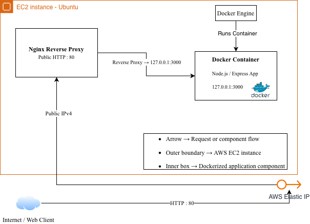
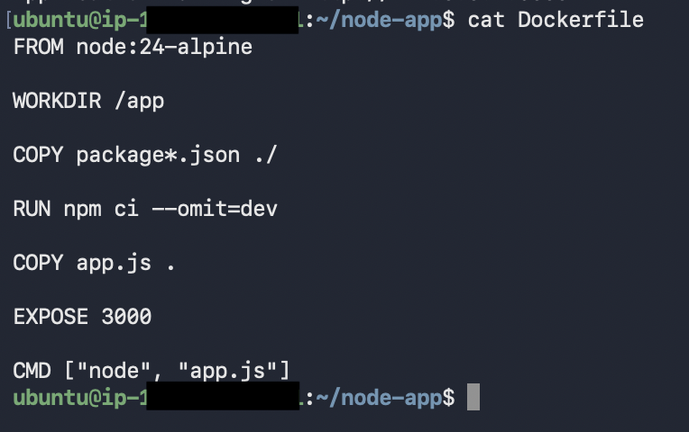
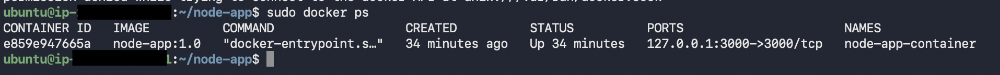
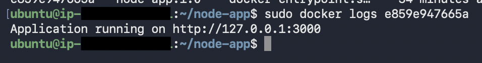
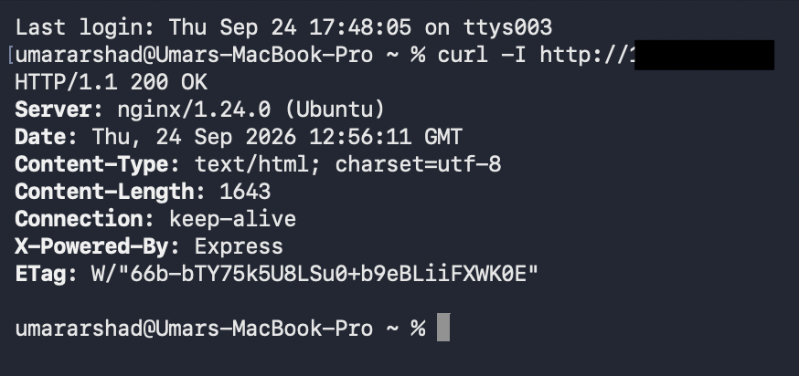
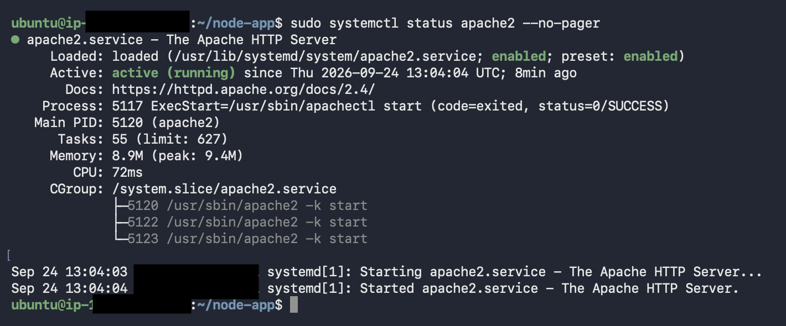
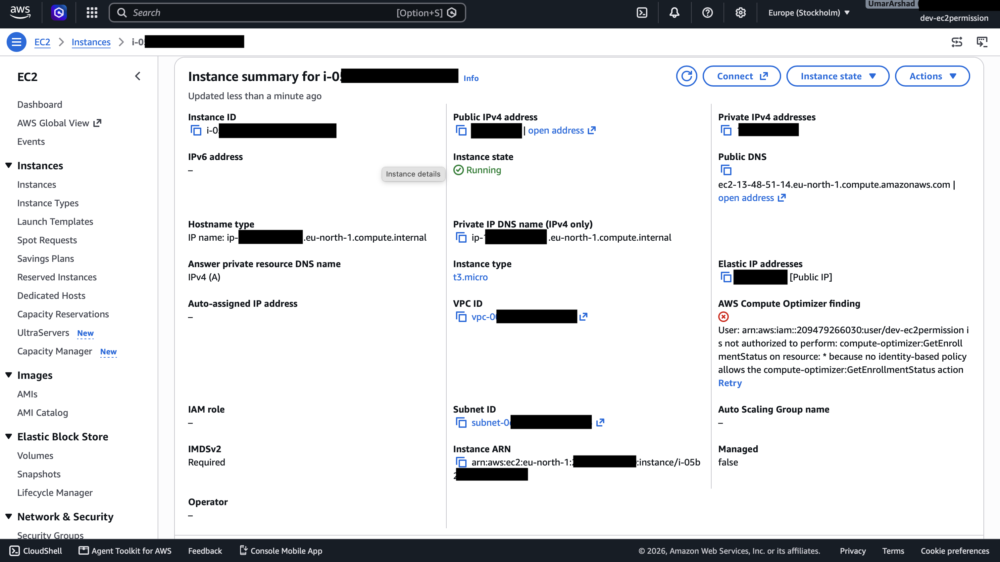

# AWS Node.js Docker Deployment

A containerized Node.js/Express application deployed on an AWS EC2 Ubuntu server using Docker and Nginx as a reverse proxy.

This project demonstrates containerization, reverse proxy configuration, deployment verification, and basic network isolation on AWS.

## Architecture



**Request flow:** Internet → AWS Elastic IP → EC2 Ubuntu → Nginx on port 80 → Dockerized Node.js/Express application on `127.0.0.1:3000`.

## Technologies

- AWS EC2 and Elastic IP
- Ubuntu Linux
- Node.js and Express.js
- Docker
- Nginx
- Git and GitHub

## Deployment Features

- Node.js application running inside a Docker container
- Nginx configured as a reverse proxy
- Application port 3000 bound to `127.0.0.1`, rather than exposed directly to the internet
- Public HTTP traffic routed through Nginx on port 80
- AWS Security Group configured to restrict SSH access
- Docker container configured with the `unless-stopped` restart policy
- Docker image built on the EC2 instance
- Application source code tracked with Git and GitHub

## Project Structure

```text
aws-nodejs-docker-deployment/
├── app.js
├── Dockerfile
├── .dockerignore
├── .gitignore
├── package.json
├── package-lock.json
├── README.md
└── docs/
    └── screenshots/
        ├── aws-nodejs-docker-architecture.png
        └── ...
```

## Deployment Screenshots

### Docker Configuration

**Dockerfile**



### Running Containers



### Application Logs



### Nginx Configuration Validation


### Nginx Reverse Proxy Verification



### Application Running



### EC2 and Nginx



## Run Locally with Node.js

Install dependencies:

```bash
npm install
```

Start the application:

```bash
node app.js
```

The application listens on:

```text
http://localhost:3000
```

## Build the Docker Image

```bash
docker build -t node-app:1.0 .
```

## Run the Docker Container

```bash
docker run -d \
  --name node-app-container \
  -p 127.0.0.1:3000:3000 \
  node-app:1.0
```

## Configure the Restart Policy

```bash
docker update --restart unless-stopped node-app-container
```

## Nginx Reverse Proxy

Nginx forwards incoming HTTP requests on port 80 to the Node.js application at `127.0.0.1:3000`.

Example server configuration:

```nginx
server {
    listen 80;
    listen [::]:80;

    server_name _;

    location / {
        proxy_pass http://127.0.0.1:3000;

        proxy_http_version 1.1;

        proxy_set_header Host $host;
        proxy_set_header X-Real-IP $remote_addr;
        proxy_set_header X-Forwarded-For $proxy_add_x_forwarded_for;
        proxy_set_header X-Forwarded-Proto $scheme;
    }
}
```

Validate and reload Nginx:

```bash
sudo nginx -t
sudo systemctl reload nginx
```

## Security

The application port is bound to the EC2 instance's loopback interface instead of being published directly to the internet.

```text
127.0.0.1:3000 → Container port 3000
```

External HTTP traffic follows:

```text
Internet → Nginx → Docker → Node.js/Express
```

The AWS Security Group was configured for:

- **HTTP:** port 80
- **HTTPS:** port 443
- **SSH:** port 22 restricted to the administrator's IP address

*Opening port 443 in a Security Group does not by itself enable HTTPS; a valid TLS certificate and HTTPS server configuration are also required.*

## Useful Commands

Check running containers:

```bash
docker ps
```

View application logs:

```bash
docker logs node-app-container
```

Restart the container:

```bash
docker restart node-app-container
```

Check Nginx configuration:

```bash
sudo nginx -t
```

Check Nginx status:

```bash
sudo systemctl status nginx
```

## Deployment Verification

The deployment was tested at several levels:

1. Node.js application
2. Docker container
3. Nginx reverse proxy
4. Public AWS Elastic IP

HTTP requests returned successful `200 OK` responses during testing.

## Purpose

This project demonstrates hands-on practice with AWS EC2, Ubuntu, Docker-based application deployment, Nginx reverse proxying, network isolation, container process management, and Git-based version control.

## Author

[UmarArshad3](https://github.com/UmarArshad3)
